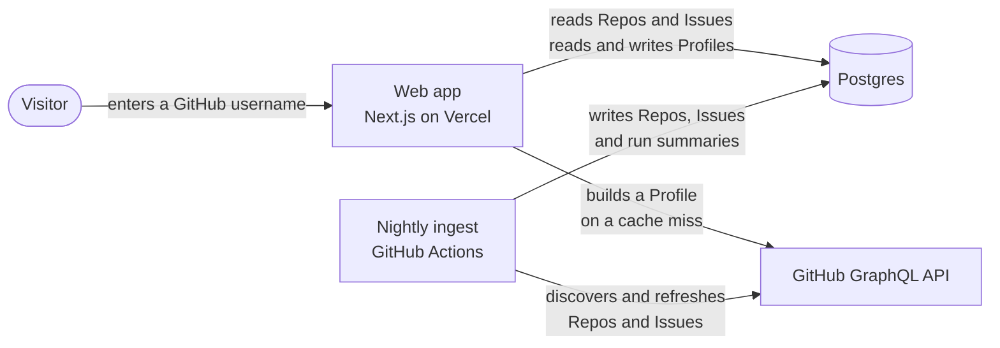
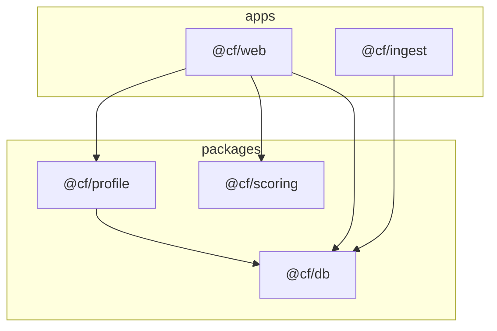
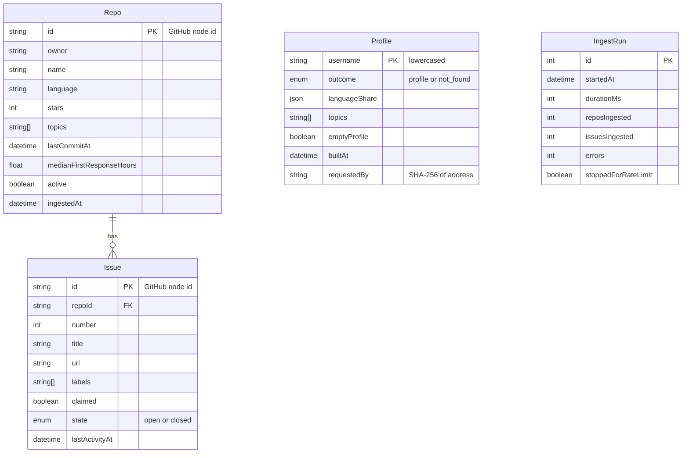
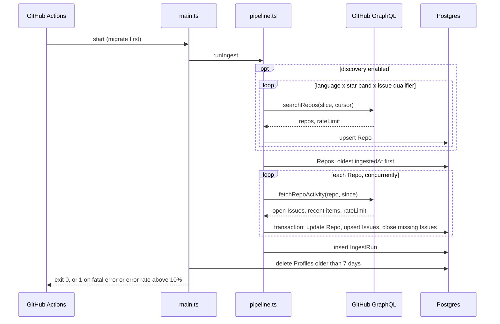
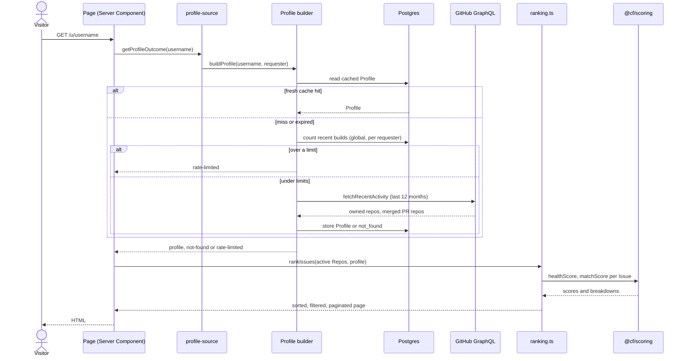
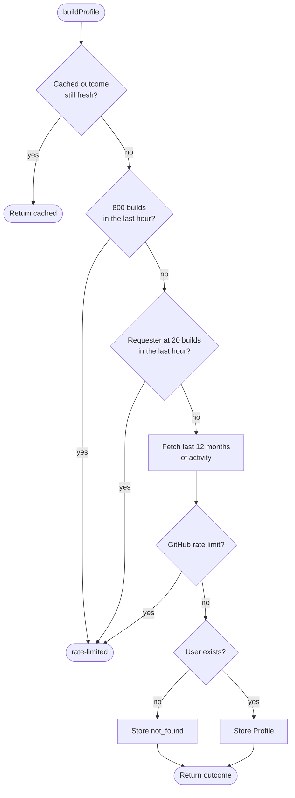
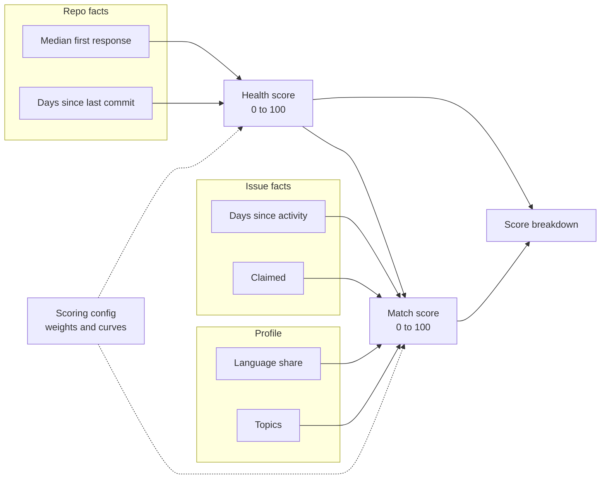
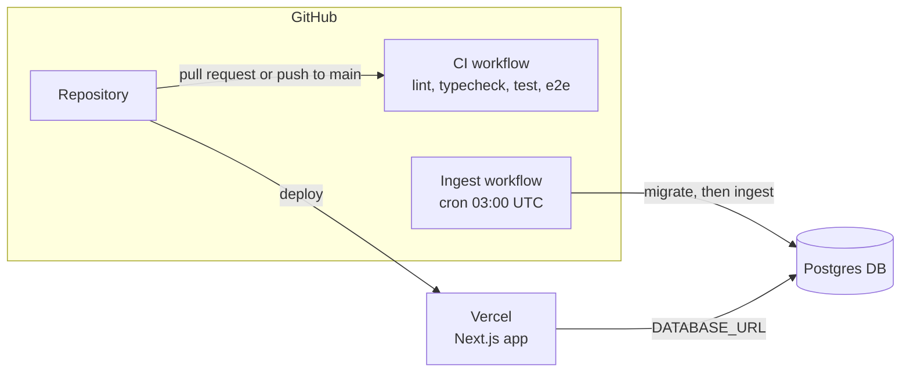

# Architecture

contribution-finder matches a GitHub user to open beginner-friendly Issues. It has two halves that share one Postgres database and never talk to each other directly:

- the **ingest**, a nightly job that copies Repos and Issues from GitHub into Postgres,
- the **web app**, which reads Postgres, builds a Profile from a username and ranks Issues against it.

Terms such as Repo, Issue, Profile and Match score are defined in the [Glossary](../../GLOSSARY.md).

## System context

The web app only calls GitHub to build a Profile for the visitor. Repo and Issue data always comes from Postgres, so a page view never depends on GitHub's availability or search limits.

## Workspace structure

The monorepo splits runnable apps from shared packages. Dependencies point one way: apps depend on packages, and packages never depend on apps.

| Package       | Responsibility                                                       |
| ------------- | -------------------------------------------------------------------- |
| `@cf/db`      | Prisma schema, migrations and `createDb()`. The only owner of tables |
| `@cf/scoring` | Health score and Match score as pure functions, plus Scoring config  |
| `@cf/profile` | Builds a Profile from GitHub, with caching and rate limiting         |
| `@cf/web`     | Screens, ranking and Issue detail                                    |
| `@cf/ingest`  | Discovery, refresh and Profile pruning                               |

`@cf/scoring` depends on nothing, so it can be tested with plain inputs. See the [repository layout](../reference/repository-layout.md) for files.

## Data model

`Profile` and `IngestRun` are standalone: nothing references them. Field details are in the [data model reference](../reference/data-model.md).

Only raw Health inputs are stored (`medianFirstResponseHours`, `lastCommitAt`). Scores are computed at read time, which is why changing the Scoring config needs no re-ingest.

## Ingest

The [ingest](how-ingest-works.md) runs from `.github/workflows/ingest.yml` at 03:00 UTC: discovery and refresh on Sundays and manual runs, refresh only on the other days.

The pipeline talks to GitHub only through the `GitHubClient` interface, so tests substitute a fake client. See the [testing approach](testing-approach.md).

## Request flow

Both screens that depend on a username (Results and Issue detail) follow the same path.

Active Repos with their open Issues are loaded once and cached for a few minutes (`'use cache'` with `cacheLife('minutes')` in `active-repos.ts`). Scoring and sorting then happen in memory per request.

## Profile builder

The builder protects the GitHub token budget with three layers before it makes a call.

| Outcome        | Cached for | Stored |
| -------------- | ---------- | ------ |
| `profile`      | 24 hours   | yes    |
| `not-found`    | 1 hour     | yes    |
| `rate-limited` | not cached | no     |

The Requester is a SHA-256 hash of the forwarded address, so the database never holds a raw IP. The reasoning is in [ADR 002](../adr/002-profile-rate-limit-strategy.md).

## Scoring

Both scores are weighted sums of normalized components. A component with no input is dropped and the remaining weights are re-normalized.

The Health score is computed first and fed into the Match score as one of its components. Weights and curves live in `packages/scoring/src/config.ts`; see the [scoring config reference](../reference/scoring-config.md).

## Deployment

Secrets and variables per environment are listed in the [environment variables reference](../reference/environment-variables.md). The workflows are described in [GitHub Actions workflows](../reference/workflows.md).

## Design decisions

| Decision                                        | Reason                                                                               |
| ----------------------------------------------- | ------------------------------------------------------------------------------------ |
| Ingest into Postgres instead of querying GitHub | GitHub search caps at 1,000 results and rate limits would make page views unreliable |
| Store raw inputs, compute scores at read time   | Scoring changes need no re-ingest                                                    |
| Ingestion time as the checkpoint                | A rate-limited run resumes on its own the next night, with no extra table            |
| One `GitHubClient` seam                         | Tests run the real pipeline against a real database with a fake network              |
| Username only, no OAuth                         | Public activity is enough to build a Profile, and visitors need no account           |
| Hashed Requester key                            | Enforces a per-visitor limit without storing addresses                               |
